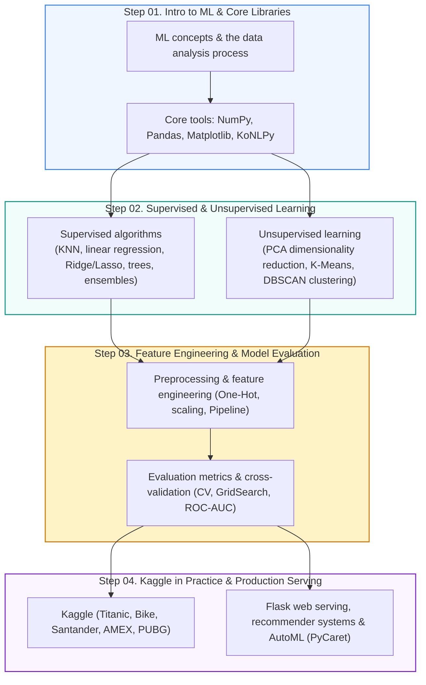

🇰🇷 [한국어](https://github.com/LDJWJ/ML_Basic_Class/blob/main/README.md) · 🇺🇸 **English** · 🇯🇵 [日本語](README.ja.md)

# 🤖 Machine Learning Basics (ML Basic Class)

<p align="center">
  <a href="https://ldjwj.github.io/ML_Basic_Class/?lang=en">
    
  </a>
  
  
  
</p>

> **Welcome!** This repository is an **open online course textbook** that takes you step by step from the core concepts and inner workings of machine learning algorithms, through real-world data preprocessing, model evaluation and tuning, and hands-on Kaggle competitions, all the way to deploying a Flask web service.  
> ⭐️ If you find it helpful, please hit the **Star** button at the top right!

> **Note:** All slides and notebooks (PDF/HTML) are in Korean. The code itself is language-independent, and your browser's built-in translation (e.g. Chrome) works on the HTML pages.

<p align="center">
  <a href="#️-learning-roadmap">🗺️ Roadmap</a> •
  <a href="#-lecture-slides-pdf-index">📚 Slides (PDF)</a> •
  <a href="#-hands-on-code-for-ml-algorithms">💻 Algorithm Code</a> •
  <a href="#-kaggle-competitions-in-practice">🏆 Kaggle</a> •
  <a href="#-applied-projects--web-serving">🚀 Projects & Serving</a>
</p>

---

## 🗺️ Learning Roadmap

A four-step curriculum that connects the fundamentals of machine learning all the way to deploying a real web service.



---

## 📚 Lecture Slides (PDF) Index

The slide decks used in class are available to view and download as PDFs.

| Stage / Topic | Title | File |
|:---|:---|:---:|
| **Intro & Overview** | ML terminology, types, and the data analysis process (latest v16) | [📄 PDF](https://ldjwj.github.io/ML_Basic_Class/part03_ml/part03_ch01_01_ml/ch01_01_ML입문_Detail_v16_202610.pdf) |
| | Understanding ML basics (overview edition, latest v22) | [📄 PDF](https://ldjwj.github.io/ML_Basic_Class/part03_ml/part03_ch01_01_ml/ch01_01_ML입문_v22_202610.pdf) |
| | ML basics: Python and your first model (latest v14) | [📄 PDF](https://ldjwj.github.io/ML_Basic_Class/part03_ml/part03_ch01_01_ml/ch01_02_ML기본_v14_202610.pdf) |
| **Supervised (Regression/Classification)** | KNN & linear regression (latest V119 revision, with opencode) | [📄 PDF](https://ldjwj.github.io/ML_Basic_Class/part03_ml/ch02_01_ML_KNN_회귀_V119_2610.pdf) |
| | KNN & linear regression (for beginners) | [📄 PDF](https://ldjwj.github.io/ML_Basic_Class/part03_ml/part03_ch02_01_knn_linear_ppt/ch02_AI_KNN_회귀_HighSc_V10.pdf) |
| | Logistic Regression | [📄 PDF](https://ldjwj.github.io/ML_Basic_Class/part03_ml/part03_ch02_01_knn_linear_ppt/ch02_logistic_v03_202610.pdf) |
| | Decision Tree (latest v13) | [📄 PDF](https://ldjwj.github.io/ML_Basic_Class/part03_ml/part03_ch02_02_decisiontree/ch02_03_01_decisiontree_v13_202610.pdf) |
| | Ensembles - bagging, random forest, boosting, LightGBM (parts 01 & 02 combined) | [📄 PDF](https://ldjwj.github.io/ML_Basic_Class/part03_ml/part03_ch02_03_ensemble/ch02_Ensemble_v12_202610.pdf) |
| **Preprocessing & Unsupervised** | Data preprocessing & feature engineering (latest v12, Oct 2026) | [📄 PDF](https://ldjwj.github.io/ML_Basic_Class/part03_ml/part03_ch03_01_datapre/ch03_04_01_DataProcessing_202610_v12.pdf) |
| | Pipeline concepts (v11, Oct 2026) | [📄 PDF](https://ldjwj.github.io/ML_Basic_Class/part03_ml/part03_ch03_01_datapre/ch03_04_02_Pipeline_202610_v11.pdf) |
| | Unsupervised learning 01: overview | [📄 PDF](https://ldjwj.github.io/ML_Basic_Class/part03_ml/part03_ch03_02_pca/ch03_비지도학습01_Basic_v02_202610.pdf) |
| | Unsupervised learning 02: PCA (principal component analysis) | [📄 PDF](https://ldjwj.github.io/ML_Basic_Class/part03_ml/part03_ch03_02_pca/ch03_pca_v02_202610.pdf) |
| **Evaluation & Recommenders** | A complete guide to ML evaluation metrics | [📄 PDF](https://ldjwj.github.io/ML_Basic_Class/part03_ml/part03_ch05_validation/ch05_평가지표_v05_202610.pdf) |
| | Going further: strategies for upgrading your models (latest v02) | [📄 PDF](https://ldjwj.github.io/ML_Basic_Class/part03_ml/part03_ch06_upgrade/ch06_upgrade_v02_202610.pdf) |
| | Recommendation systems: overview (latest v03) | [📄 PDF](https://ldjwj.github.io/ML_Basic_Class/part04_practical/ch07_추천시스템_v03_202610.pdf) |

---

## 💻 Hands-on Code for ML Algorithms

Every notebook is available both as an **HTML viewer** you can open right in the browser and as a **PDF** for printing or keeping.

> [!NOTE]
> **October 2026 run check**: the hands-on notebooks were re-run on current libraries (Python 3.12, scikit-learn 1.9, pandas 3.0) and on Google Colab. The 39 that no longer ran were fixed as new `*_2610` versions, and their HTML and PDF files were rebuilt (verified 2026-10-16).
> Links in the tables below now point to the fixed versions where one exists; the full list is in the [“2026.10 run-check fixes” section of the web textbook](https://ldjwj.github.io/ML_Basic_Class/?lang=en#sec15). The older HTML and PDF files are kept as they were.

### 1. Core Libraries & Exploratory Data Analysis (EDA)
| Topic | Details | Links |
|:---|:---|:---:|
| **Pandas** | Data exploration basics (IRIS) | [🌐 HTML](https://ldjwj.github.io/ML_Basic_Class/part03_ml/1_2_LIB_Pandas_Basic01_IRIS_V12_2610.html) · [📄 PDF](https://ldjwj.github.io/ML_Basic_Class/part03_ml/1_2_LIB_Pandas_Basic01_IRIS_V12_2610.pdf) |
| | Key methods (`unique`, `value_counts`) | [🌐 HTML](https://ldjwj.github.io/ML_Basic_Class/part03_ml/1_2_LIB_Pandas_Basic02_IRIS_V11.html) · [📄 PDF](https://ldjwj.github.io/ML_Basic_Class/part03_ml/1_2_LIB_Pandas_Basic02_IRIS_V11.pdf) |
| **Matplotlib** | Drawing basic charts | [🌐 HTML](https://ldjwj.github.io/ML_Basic_Class/part03_ml/1_2_LIB_Matplotlib_Basic01_IRIS_V11.html) · [📄 PDF](https://ldjwj.github.io/ML_Basic_Class/part03_ml/1_2_LIB_Matplotlib_Basic01_IRIS_V11.pdf) |
| **Scikit-learn** | First steps with scikit-learn (loading the IRIS dataset) | [🌐 HTML](https://ldjwj.github.io/ML_Basic_Class/part03_ml/1_2_LIB_sklearn_Basic01_IRIS_V02.html) · [📄 PDF](https://ldjwj.github.io/ML_Basic_Class/part03_ml/1_2_LIB_sklearn_Basic01_IRIS_V02.pdf) |
| **NumPy & NLP** | Multi-dimensional array operations & vectorization | [🌐 HTML](https://ldjwj.github.io/ML_Basic_Class/part03_ml/1_1_numpy라이브러리_V11.html) · [📄 PDF](https://ldjwj.github.io/ML_Basic_Class/part03_ml/1_1_numpy라이브러리_V11.pdf) |
| | Korean morphological analysis (KoNLPy on Colab) | [🌐 HTML](https://ldjwj.github.io/ML_Basic_Class/part03_ml/1_2_LIB_KONLPY_V11_2610.html) · [📄 PDF](https://ldjwj.github.io/ML_Basic_Class/part03_ml/1_2_LIB_KONLPY_V11_2610.pdf) |
| | YouTube comment text analysis & word cloud | [🌐 HTML](https://ldjwj.github.io/ML_Basic_Class/part03_ml/1_2_LIB_KONLPY_Youtube03_V11_2610.html) · [📄 PDF](https://ldjwj.github.io/ML_Basic_Class/part03_ml/1_2_LIB_KONLPY_Youtube03_V11_2610.pdf) |

### 2. Supervised Learning
| Category | Topic | Links |
|:---|:---|:---:|
| **First model** | Building and training your first ML model | [🌐 HTML](https://ldjwj.github.io/ML_Basic_Class/part03_ml/ch01_01_ML_start_v14_2606.html) |
| **KNN** | Implementing k-nearest neighbors | [🌐 HTML](https://ldjwj.github.io/ML_Basic_Class/part03_ml/ch02_01_01A_knn_code_v12_504.html) · [📄 PDF](https://ldjwj.github.io/ML_Basic_Class/part03_ml/ch02_01_01A_knn_code_v12_504.pdf) |
| | KNN practice exercises | [🌐 HTML](https://ldjwj.github.io/ML_Basic_Class/part03_ml/ch02_01_01B_knn_code_pratice_2205.html) · [📄 PDF](https://ldjwj.github.io/ML_Basic_Class/part03_ml/ch02_01_01B_knn_code_pratice_2205.pdf) |
| **Linear models** | Simple & multiple linear regression | [🌐 HTML](https://ldjwj.github.io/ML_Basic_Class/part03_ml/ch02_01_02A_linear_code_v12.html) · [📄 PDF](https://ldjwj.github.io/ML_Basic_Class/part03_ml/ch02_01_02A_linear_code_v12.pdf) |
| | Regression metrics in depth (diabetes dataset) | [🌐 HTML](https://ldjwj.github.io/ML_Basic_Class/part03_ml/ch02_01_02B_diabete_evaluation_v13_2601.html) · [📄 PDF](https://ldjwj.github.io/ML_Basic_Class/part03_ml/ch02_01_02B_diabete_evaluation_v13_2601.pdf) |
| | Regularized linear regression (Ridge, Lasso) | [🌐 HTML](https://ldjwj.github.io/ML_Basic_Class/part03_ml/ch02_01_03_ridge_lasso.html) · [📄 PDF](https://ldjwj.github.io/ML_Basic_Class/part03_ml/ch02_01_03_ridge_lasso.pdf) |
| | Logistic binary classification | [🌐 HTML](https://ldjwj.github.io/ML_Basic_Class/part03_ml/ch02_01_04_binary_classification_v11_2610.html) · [📄 PDF](https://ldjwj.github.io/ML_Basic_Class/part03_ml/ch02_01_04_binary_classification_v11_2610.pdf) |
| | Multiclass classification | [🌐 HTML](https://ldjwj.github.io/ML_Basic_Class/part03_ml/ch02_01_05_multiclass_classification_v10.html) · [📄 PDF](https://ldjwj.github.io/ML_Basic_Class/part03_ml/ch02_01_05_multiclass_classification_v10.pdf) |
| **Trees & Ensembles** | Decision tree basics (Colab) | [🌐 HTML](https://ldjwj.github.io/ML_Basic_Class/part03_ml/ch02_03_01_decisionTree_colab.html) · [📄 PDF](https://ldjwj.github.io/ML_Basic_Class/part03_ml/ch02_03_01_decisionTree_colab.pdf) |
| | Decision tree on the diabetes dataset | [🌐 HTML](https://ldjwj.github.io/ML_Basic_Class/part03_ml/ch02_03_02_decisionTree_diabetes_colab_v11_2610.html) · [📄 PDF](https://ldjwj.github.io/ML_Basic_Class/part03_ml/ch02_03_02_decisionTree_diabetes_colab_v11_2610.pdf) |
| | Interpreting tree models with `dtreeviz` | [🌐 HTML](https://ldjwj.github.io/ML_Basic_Class/part03_ml/ch02_03_02_dtreeviz_modelVis_v11_2610.html) · [📄 PDF](https://ldjwj.github.io/ML_Basic_Class/part03_ml/ch02_03_02_dtreeviz_modelVis_v11_2610.pdf) |
| | Random forest - Tips dataset (1, 2) | [🌐 HTML 01](https://ldjwj.github.io/ML_Basic_Class/part03_ml/ch02_03_03_RandomForest_01_Tips_01.html) · [🌐 HTML 02](https://ldjwj.github.io/ML_Basic_Class/part03_ml/ch02_03_03_RandomForest_01_Tips_02.html) |
| | Random forest - breast cancer classification | [🌐 HTML](https://ldjwj.github.io/ML_Basic_Class/part03_ml/ch02_03_03_RandomForest_02_cancer_v11_2610.html) · [📄 PDF](https://ldjwj.github.io/ML_Basic_Class/part03_ml/ch02_03_03_RandomForest_02_cancer_v11_2610.pdf) |
| | Gradient boosting decision trees (GBM) | [🌐 HTML](https://ldjwj.github.io/ML_Basic_Class/part03_ml/ch02_03_05_gradient_boosting_class_v11.html) · [📄 PDF](https://ldjwj.github.io/ML_Basic_Class/part03_ml/ch02_03_05_gradient_boosting_class_v11.pdf) |

### 3. Preprocessing, Unsupervised Learning, and Model Validation
| Category | Details | Links |
|:---|:---|:---:|
| **Preprocessing** | Handling missing values & scaling | [🌐 HTML](https://ldjwj.github.io/ML_Basic_Class/part03_ml/ch03_01_01_데이터전처리_2208.html) · [📄 PDF](https://ldjwj.github.io/ML_Basic_Class/part03_ml/ch03_01_01_데이터전처리_2208.pdf) |
| | One-hot encoding categorical data | [🌐 HTML](https://ldjwj.github.io/ML_Basic_Class/part03_ml/ch04_01_01_FE_OneHotEncoding_01.html) · [📄 PDF](https://ldjwj.github.io/ML_Basic_Class/part03_ml/ch04_01_01_FE_OneHotEncoding_01.pdf) |
| | Binning & log transforms | [🌐 HTML](https://ldjwj.github.io/ML_Basic_Class/part03_ml/ch04_05_01_FE_binned_v11_2610.html) · [📄 PDF](https://ldjwj.github.io/ML_Basic_Class/part03_ml/ch04_06_01_FE_log_v11_2610.pdf) |
| | ML pipelines (Pipeline code) | [🌐 HTML](https://ldjwj.github.io/ML_Basic_Class/part03_ml/ch04_08_01_Pipeline_Code_2210.html) · [📄 PDF](https://ldjwj.github.io/ML_Basic_Class/part03_ml/ch04_08_01_Pipeline_Code_2210.pdf) |
| **Unsupervised** | PCA dimensionality reduction basics & face image example | [🌐 HTML](https://ldjwj.github.io/ML_Basic_Class/part03_ml/ch03_04_01_차원축소(1)_PCA_v11_2610.html) · [📄 PDF](https://ldjwj.github.io/ML_Basic_Class/part03_ml/ch03_04_02_차원축소(2)_PCA_얼굴예제_v11_2610.pdf) |
| | Visualizing with t-SNE (nonlinear dimensionality reduction) | [🌐 HTML](https://ldjwj.github.io/ML_Basic_Class/part03_ml/ch03_04_03_차원축소(3)_tsne_2208.html) · [📄 PDF](https://ldjwj.github.io/ML_Basic_Class/part03_ml/ch03_04_03_차원축소(3)_tsne_2208.pdf) |
| | K-Means clustering & DBSCAN density-based clustering | [🌐 HTML](https://ldjwj.github.io/ML_Basic_Class/part03_ml/ch03_02_01_군집(clustering)_Kmeans_2208.html) · [🌐 HTML](https://ldjwj.github.io/ML_Basic_Class/part03_ml/ch03_05_02_DBSCAN_v11_2610.html) |
| **Evaluation & Tuning** | Cross-validation (1, 2) | [🌐 HTML 01](https://ldjwj.github.io/ML_Basic_Class/part03_ml/ch05_01_01_CrossValidation_v01_2208.html) · [🌐 HTML 02](https://ldjwj.github.io/ML_Basic_Class/part03_ml/ch05_01_02_CrossValidation_v03_2610.html) |
| | Hyperparameter search with GridSearchCV | [🌐 HTML 01](https://ldjwj.github.io/ML_Basic_Class/part03_ml/ch05_02_03_GridSearch_tree_v11_2610.html) · [🌐 HTML 02](https://ldjwj.github.io/ML_Basic_Class/part03_ml/ch05_02_02_성능개선_GridSearch2.html) |
| | ROC-AUC curves & adjusting the classification threshold | [🌐 HTML](https://ldjwj.github.io/ML_Basic_Class/part03_ml/ch05_03_03_validation(3)-ROCAUC_v11_2610.html) · [📄 PDF](https://ldjwj.github.io/ML_Basic_Class/part03_ml/ch05_03_02_validation(2)_threshold_v11_2610.pdf) |

---

## 🏆 Kaggle Competitions in Practice

Using datasets from real public competitions, we go from building a baseline model through feature engineering to tuning top-ranked solutions.

<details open markdown="1">
<summary><b>🔥 Hands-on work by competition (click to collapse/expand)</b></summary>

### 1. Titanic - Survival Prediction
* [Intro] Making your first submission [🌐 HTML](https://ldjwj.github.io/ML_Basic_Class/part03_ml/part03_pro_titanic/ch02_03_02A_titanic_firstsub_2205.html) · [📄 PDF](https://ldjwj.github.io/ML_Basic_Class/part03_ml/part03_pro_titanic/ch02_03_02A_titanic_firstsub_2205.pdf)
* [EDA] Data exploration & model comparison [🌐 HTML](https://ldjwj.github.io/ML_Basic_Class/part03_ml/part03_pro_titanic/ch02_03_02B_titanic.html) · [📄 PDF](https://ldjwj.github.io/ML_Basic_Class/part03_ml/part03_pro_titanic/ch02_03_02B_titanic.pdf)
* [Feature engineering] Advanced parsing of Cabin and Ticket [🌐 HTML Cabin](https://ldjwj.github.io/ML_Basic_Class/part03_ml/ch02_03_02B_01_Cabin(0_67703)_v11_2610.html) · [🌐 HTML Ticket](https://ldjwj.github.io/ML_Basic_Class/part03_ml/ch02_03_02B_02_Ticket_gender_v11_2610.html)
* [Model evaluation] Validation strategy for Titanic [🌐 HTML](https://ldjwj.github.io/ML_Basic_Class/part03_ml/ch05_03_05_validation_titanic_2211.html)

### 2. Bike Sharing Demand
* (1) EDA & data visualization [🌐 HTML](https://ldjwj.github.io/ML_Basic_Class/part03_ml/01_06_Bike_EDA_02_2107.html) · [📄 PDF](https://ldjwj.github.io/ML_Basic_Class/part03_ml/01_06_Bike_EDA_02_2107.pdf)
* (2) Building Ridge & Lasso regression models [🌐 HTML](https://ldjwj.github.io/ML_Basic_Class/part03_ml/ch02_Bike02_Ridge_Lasso_v13_2210.html) · [📄 PDF](https://ldjwj.github.io/ML_Basic_Class/part03_ml/ch02_Bike02_Ridge_Lasso_v13_2210.pdf)
* (3) Comparing multiple models & validating performance [🌐 HTML](https://ldjwj.github.io/ML_Basic_Class/part03_ml/ch02_Bike03_MultiModel_v12.html) · [🌐 HTML Validation](https://ldjwj.github.io/ML_Basic_Class/part03_ml/ch02_Bike04_ModelValidation_v10.html)

### 3. American Express - Default Prediction
* [Competition page](https://www.kaggle.com/competitions/amex-default-prediction/overview)
* Baseline model (XGBoost) [🌐 HTML](https://ldjwj.github.io/ML_Basic_Class/part03_ml/part03_pro_kaggle/amex_01_basemodel_xgbm_2210.html)
* Fast training on large data (LightGBM) [🌐 HTML](https://ldjwj.github.io/ML_Basic_Class/part03_ml/part03_pro_kaggle/amex-02-basic-lightgbm_2208.html)
* GPU-accelerated categorical modeling (CatBoost) [🌐 HTML](https://ldjwj.github.io/ML_Basic_Class/part03_ml/part03_pro_kaggle/amex-03-catboost-md10-gpu_2208.html)

### 4. Santander Customer Satisfaction
* [Competition page](https://www.kaggle.com/c/santander-customer-satisfaction)
* Optimizing ROC-AUC on imbalanced data [🌐 HTML](https://ldjwj.github.io/ML_Basic_Class/part03_ml/ch08_01_santander_roc_auc_2208.html) · [📄 PDF](https://ldjwj.github.io/ML_Basic_Class/part03_ml/ch08_01_santander_roc_auc_2208.pdf)
* LightGBM hyperparameter tuning [🌐 HTML](https://ldjwj.github.io/ML_Basic_Class/part03_ml/ch08_02_santander_lightgbm_2208.html) · [📄 PDF](https://ldjwj.github.io/ML_Basic_Class/part03_ml/ch08_02_santander_lightgbm_2208.pdf)

### 5. PUBG Finish Placement Prediction & Time-Series Sales Forecasting
* PUBG linear regression baseline [🌐 HTML](https://ldjwj.github.io/ML_Basic_Class/part03_ml/part03_pro_kaggle/pubg_01_simplesub_wk_2211.html) · [📄 PDF](https://ldjwj.github.io/ML_Basic_Class/part03_ml/part03_pro_kaggle/pubg_01_simplesub_wk_2211.pdf)
* Predict Future Sales [🌐 HTML 01](https://ldjwj.github.io/ML_Basic_Class/part03_ml/part03_pro_kaggle/01_predict_future_sales_v10.html) · [🌐 HTML 02](https://ldjwj.github.io/ML_Basic_Class/part03_ml/part03_pro_kaggle/02_predict_future_sales_v10.html)
* Dacon parking demand forecasting baseline [🌐 HTML](https://ldjwj.github.io/ML_Basic_Class/part03_ml/part03_pro_kaggle/dacon_07_feature_engineering_01.html) · [GitHub Repo](https://github.com/LDJWJ/parking_demand_competion)

</details>

---

## 🚀 Applied Projects & Web Serving

```
┌─────────────────────────────────────┐       ┌─────────────────────────────────────┐
│   🌐 ML Web Services with Flask     │  -->  │   🛒 Intelligent Recommender        │
│  - Real-time IRIS species classifier│       │  - Collaborative filtering          │
│  - California house price web UI    │       │  - TF-IDF content-based JS demo     │
└─────────────────────────────────────┘       └─────────────────────────────────────┘
```

### 1. Deploying ML Web Services with Flask
Load a trained model (`.pkl`) into Flask, a lightweight web framework, and serve real-time predictions from user input.
* **Iris species classifier**: [🌐 HTML](https://ldjwj.github.io/ML_Basic_Class/part04_practical/Flask(플라스크)_머신러닝_웹서비스구축.html) · [📄 PDF](https://ldjwj.github.io/ML_Basic_Class/part04_practical/Flask_Web01_IRIS.pdf)
* **House price prediction**: [🌐 HTML](https://ldjwj.github.io/ML_Basic_Class/part04_practical/Flask(플라스크)_활용한_머신러닝_웹서비스구축(2).html) · [📄 PDF](https://ldjwj.github.io/ML_Basic_Class/part04_practical/Flask_Web02_House.pdf)
* **Malignant tumor (cancer) prediction**: [🌐 HTML](https://ldjwj.github.io/ML_Basic_Class/part04_practical/Flask_ML_Web서비스(3)_Cancer.html) · [📄 PDF](https://ldjwj.github.io/ML_Basic_Class/part04_practical/Flask_Web03_Cancer.pdf)

### 2. Recommendation Systems
* Recommending similar movies from ratings (collaborative filtering): [🌐 HTML](https://ldjwj.github.io/ML_Basic_Class/part04_practical/ch07_03_협업필터링_movie_01_2211.html) · [📄 PDF](https://ldjwj.github.io/ML_Basic_Class/part04_practical/ch07_03_협업필터링_movie_01_2211.pdf)
* TF-IDF content-based recommender: [🌐 HTML](https://ldjwj.github.io/ML_Basic_Class/part04_practical/ch07_04_콘텐츠기반_TFIDF_movie_2606.html)
* **[Interactive demo]** Pick movies in your browser and get recommendations instantly: [🎮 Launch demo](https://ldjwj.github.io/ML_Basic_Class/part04_practical/ch07_04_콘텐츠기반_TFIDF_movie_interactive_2606.html)

### 3. AutoML (PyCaret) & Database Pipelines
* **PyCaret AutoML**: One-click model comparison & ensembling [🌐 HTML](https://ldjwj.github.io/ML_Basic_Class/part03_ml/ch08_03_Automl_pycaret01_2211.html)
* **Spaceship Titanic** AutoML solution: [🌐 HTML](https://ldjwj.github.io/ML_Basic_Class/part03_ml/ch08_03_Automl_spaceship_titanic_2207.html)
* **SQLite DB & Pandas**: Connecting a data pipeline [🌐 HTML 01](https://ldjwj.github.io/ML_Basic_Class/part03_ml/ch08_01_ml_db.html) · [🌐 HTML 02](https://ldjwj.github.io/ML_Basic_Class/part03_ml/ch08_ml_db_02.html)

---

## 🔗 References & License

* **Reference book**: *Introduction to Machine Learning with Python (O'Reilly)*
* **Contact**: Copyright inquiries & partnerships: [frontier1020@naver.com](mailto:frontier1020@naver.com)
* **License**: All materials in this repository are licensed under [CC BY-NC 4.0](LICENSE). You may freely use and share them for non-commercial purposes with attribution.
