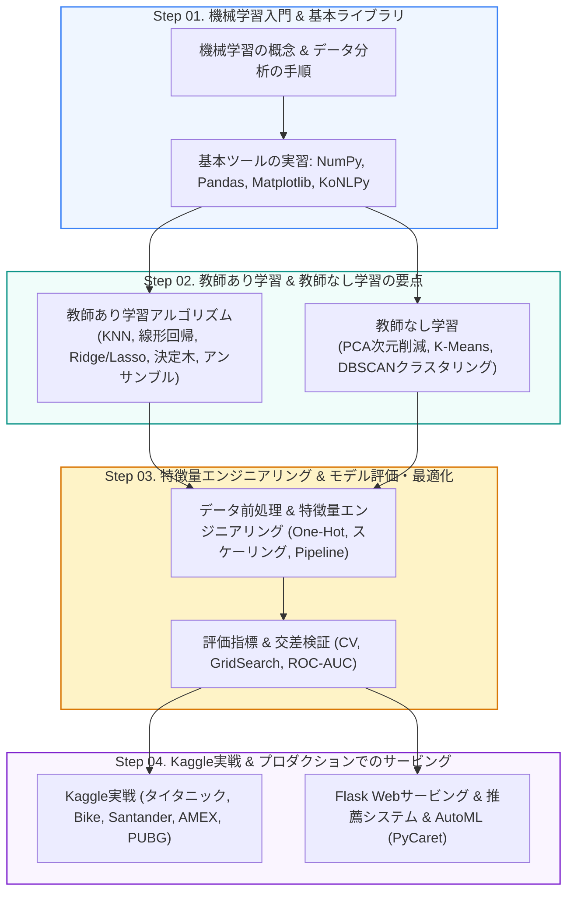

<p align="center">
  🇰🇷 <a href="README.md">한국어</a> | 🇺🇸 <a href="README.en.md">English</a> | 🇯🇵 <b>日本語</b>
</p>

# 🤖 機械学習の基本 (ML Basic Class)

<p align="center">
  <a href="https://ldjwj.github.io/ML_Basic_Class/?lang=ja">
    
  </a>
  
  
  
</p>

> **ようこそ！** 本リポジトリは、機械学習の核となる概念とアルゴリズムの原理から、実務でのデータ前処理、モデルの評価・最適化、Kaggleコンペの実践、そしてFlaskによるWebサービスのデプロイまでを段階的に学べる **オンラインのオープン講義教材** です。  
> ⭐️ 役に立ったら、右上の **Star** ボタンを押していただけるとうれしいです！

> [!NOTE]
> 教材（PDF/HTML）はすべて **韓国語** で書かれています。Pythonコードはそのまま実行できるので、コードとグラフを追いながら学習できます。

<p align="center">
  <a href="#️-学習ロードマップ">🗺️ ロードマップ</a> •
  <a href="#-講義スライド-pdf-一覧">📚 講義スライド（PDF）</a> •
  <a href="#-機械学習アルゴリズム実習コード">💻 アルゴリズム実習</a> •
  <a href="#-kaggle実戦コンペ">🏆 Kaggle実戦</a> •
  <a href="#-応用プロジェクト--webサービング">🚀 応用＆サービング</a>
</p>

---

## 🗺️ 学習ロードマップ

機械学習の基礎理論から実際のWebサービスのデプロイまで、有機的につながった4段階のカリキュラムです。



---

## 📚 講義スライド PDF 一覧

講義で使うスライド教材をPDFで閲覧・ダウンロードできます。

| 段階 / テーマ | 教材タイトル | ファイル |
|:---|:---|:---:|
| **機械学習入門 & 概要** | 機械学習の用語・分類・データ分析の手順（最新 v16） | [📄 PDF](https://ldjwj.github.io/ML_Basic_Class/part03_ml/part03_ch01_01_ml/ch01_01_ML입문_Detail_v16_202610.pdf) |
| | 機械学習の基本理解（概要版、最新 v22） | [📄 PDF](https://ldjwj.github.io/ML_Basic_Class/part03_ml/part03_ch01_01_ml/ch01_01_ML입문_v22_202610.pdf) |
| | 機械学習の基本：Pythonで初めてのモデル作り（最新 v14） | [📄 PDF](https://ldjwj.github.io/ML_Basic_Class/part03_ml/part03_ch01_01_ml/ch01_02_ML기본_v14_202610.pdf) |
| **教師あり学習（回帰/分類）** | KNN & 線形回帰（最新 V119 改訂版、with opencode） | [📄 PDF](https://ldjwj.github.io/ML_Basic_Class/part03_ml/ch02_01_ML_KNN_회귀_V119_2610.pdf) |
| | KNN & 線形回帰（初心者向け入門） | [📄 PDF](https://ldjwj.github.io/ML_Basic_Class/part03_ml/part03_ch02_01_knn_linear_ppt/ch02_AI_KNN_회귀_HighSc_V10.pdf) |
| | ロジスティック回帰（Logistic Regression） | [📄 PDF](https://ldjwj.github.io/ML_Basic_Class/part03_ml/part03_ch02_01_knn_linear_ppt/ch02_logistic_v03_202610.pdf) |
| | 決定木（Decision Tree、最新 v13） | [📄 PDF](https://ldjwj.github.io/ML_Basic_Class/part03_ml/part03_ch02_02_decisiontree/ch02_03_01_decisiontree_v13_202610.pdf) |
| | アンサンブル手法 - バギング・ランダムフォレスト・ブースティング・LightGBM（01・02統合） | [📄 PDF](https://ldjwj.github.io/ML_Basic_Class/part03_ml/part03_ch02_03_ensemble/ch02_Ensemble_v12_202610.pdf) |
| **前処理 & 教師なし学習** | データ前処理と特徴量エンジニアリング（最新 v12、2026.10） | [📄 PDF](https://ldjwj.github.io/ML_Basic_Class/part03_ml/part03_ch03_01_datapre/ch03_04_01_DataProcessing_202610_v12.pdf) |
| | パイプライン（Pipeline）の概念（v11、2026.10） | [📄 PDF](https://ldjwj.github.io/ML_Basic_Class/part03_ml/part03_ch03_01_datapre/ch03_04_02_Pipeline_202610_v11.pdf) |
| | 教師なし学習 01 基本概要 | [📄 PDF](https://ldjwj.github.io/ML_Basic_Class/part03_ml/part03_ch03_02_pca/ch03_비지도학습01_Basic_v02_202610.pdf) |
| | 教師なし学習 02 PCA 主成分分析 | [📄 PDF](https://ldjwj.github.io/ML_Basic_Class/part03_ml/part03_ch03_02_pca/ch03_pca_v02_202610.pdf) |
| **評価 & 推薦システム** | 機械学習モデルの評価指標まとめ | [📄 PDF](https://ldjwj.github.io/ML_Basic_Class/part03_ml/part03_ch05_validation/ch05_평가지표_v05_202610.pdf) |
| | 機械学習の応用 & モデル改善の戦略（最新 v02） | [📄 PDF](https://ldjwj.github.io/ML_Basic_Class/part03_ml/part03_ch06_upgrade/ch06_upgrade_v02_202610.pdf) |
| | 推薦システム（Recommendation System）概要（最新 v03） | [📄 PDF](https://ldjwj.github.io/ML_Basic_Class/part04_practical/ch07_추천시스템_v03_202610.pdf) |

---

## 💻 機械学習アルゴリズム実習コード

ブラウザですぐに見られる **HTMLビューア** と、印刷・保存用の **PDF** の両方を用意しています。

### 1. 基本ライブラリ & 探索的データ分析（EDA）
| テーマ | 内容 | リンク |
|:---|:---|:---:|
| **Pandas** | データ探索の基礎（IRIS） | [🌐 HTML](https://ldjwj.github.io/ML_Basic_Class/part03_ml/1_2_LIB_Pandas_Basic01_IRIS_V11.html) · [📄 PDF](https://ldjwj.github.io/ML_Basic_Class/part03_ml/1_2_LIB_Pandas_Basic01_IRIS_V11.pdf) |
| | 主要メソッドの活用（`unique`、`value_counts`） | [🌐 HTML](https://ldjwj.github.io/ML_Basic_Class/part03_ml/1_2_LIB_Pandas_Basic02_IRIS_V11.html) · [📄 PDF](https://ldjwj.github.io/ML_Basic_Class/part03_ml/1_2_LIB_Pandas_Basic02_IRIS_V11.pdf) |
| **Matplotlib** | 基本的なグラフの描き方 | [🌐 HTML](https://ldjwj.github.io/ML_Basic_Class/part03_ml/1_2_LIB_Matplotlib_Basic01_IRIS_V11.html) · [📄 PDF](https://ldjwj.github.io/ML_Basic_Class/part03_ml/1_2_LIB_Matplotlib_Basic01_IRIS_V11.pdf) |
| **Scikit-learn** | scikit-learnの第一歩（IRISデータセットの読み込み） | [🌐 HTML](https://ldjwj.github.io/ML_Basic_Class/part03_ml/1_2_LIB_sklearn_Basic01_IRIS_V02.html) · [📄 PDF](https://ldjwj.github.io/ML_Basic_Class/part03_ml/1_2_LIB_sklearn_Basic01_IRIS_V02.pdf) |
| **NumPy & NLP** | 多次元配列の演算とベクトル化 | [🌐 HTML](https://ldjwj.github.io/ML_Basic_Class/part03_ml/1_1_numpy라이브러리_V11.html) · [📄 PDF](https://ldjwj.github.io/ML_Basic_Class/part03_ml/1_1_numpy라이브러리_V11.pdf) |
| | 韓国語の形態素解析（KoNLPy on Colab） | [🌐 HTML](https://ldjwj.github.io/ML_Basic_Class/part03_ml/1_2_LIB_KONLPY_V10.html) · [📄 PDF](https://ldjwj.github.io/ML_Basic_Class/part03_ml/1_2_LIB_KONLPY_V10.pdf) |
| | YouTubeコメントのテキスト分析 & ワードクラウド | [🌐 HTML](https://ldjwj.github.io/ML_Basic_Class/part03_ml/1_2_LIB_KONLPY_Youtube03_V10.html) · [📄 PDF](https://ldjwj.github.io/ML_Basic_Class/part03_ml/1_2_LIB_KONLPY_Youtube03_V10.pdf) |

### 2. 教師あり学習（Supervised Learning）
| 分類 | テーマ | リンク |
|:---|:---|:---:|
| **最初のモデル** | 初めての機械学習モデルの作成と学習の流れ | [🌐 HTML](https://ldjwj.github.io/ML_Basic_Class/part03_ml/ch01_01_ML_start_v14_2606.html) |
| **KNN** | k近傍法アルゴリズムの実装 | [🌐 HTML](https://ldjwj.github.io/ML_Basic_Class/part03_ml/ch02_01_01A_knn_code_v12_504.html) · [📄 PDF](https://ldjwj.github.io/ML_Basic_Class/part03_ml/ch02_01_01A_knn_code_v12_504.pdf) |
| | KNN 実践練習問題 | [🌐 HTML](https://ldjwj.github.io/ML_Basic_Class/part03_ml/ch02_01_01B_knn_code_pratice_2205.html) · [📄 PDF](https://ldjwj.github.io/ML_Basic_Class/part03_ml/ch02_01_01B_knn_code_pratice_2205.pdf) |
| **線形モデル** | 単回帰・重回帰の実装 | [🌐 HTML](https://ldjwj.github.io/ML_Basic_Class/part03_ml/ch02_01_02A_linear_code_v12.html) · [📄 PDF](https://ldjwj.github.io/ML_Basic_Class/part03_ml/ch02_01_02A_linear_code_v12.pdf) |
| | 回帰の評価指標の詳細分析（糖尿病データ） | [🌐 HTML](https://ldjwj.github.io/ML_Basic_Class/part03_ml/ch02_01_02B_diabete_evaluation_v13_2601.html) · [📄 PDF](https://ldjwj.github.io/ML_Basic_Class/part03_ml/ch02_01_02B_diabete_evaluation_v13_2601.pdf) |
| | 正則化線形回帰（Ridge、Lasso） | [🌐 HTML](https://ldjwj.github.io/ML_Basic_Class/part03_ml/ch02_01_03_ridge_lasso.html) · [📄 PDF](https://ldjwj.github.io/ML_Basic_Class/part03_ml/ch02_01_03_ridge_lasso.pdf) |
| | ロジスティック回帰による二値分類（Binary） | [🌐 HTML](https://ldjwj.github.io/ML_Basic_Class/part03_ml/ch02_01_04_binary_classification.html) · [📄 PDF](https://ldjwj.github.io/ML_Basic_Class/part03_ml/ch02_01_04_binary_classification.pdf) |
| | 多クラス分類（Multiclass） | [🌐 HTML](https://ldjwj.github.io/ML_Basic_Class/part03_ml/ch02_01_05_multiclass_classification_v10.html) · [📄 PDF](https://ldjwj.github.io/ML_Basic_Class/part03_ml/ch02_01_05_multiclass_classification_v10.pdf) |
| **決定木 & アンサンブル** | 決定木の基本（Colab） | [🌐 HTML](https://ldjwj.github.io/ML_Basic_Class/part03_ml/ch02_03_01_decisionTree_colab.html) · [📄 PDF](https://ldjwj.github.io/ML_Basic_Class/part03_ml/ch02_03_01_decisionTree_colab.pdf) |
| | 決定木 糖尿病データの実習 | [🌐 HTML](https://ldjwj.github.io/ML_Basic_Class/part03_ml/ch02_03_02_decisionTree_diabetes_colab.html) · [📄 PDF](https://ldjwj.github.io/ML_Basic_Class/part03_ml/ch02_03_02_decisionTree_diabetes_colab.pdf) |
| | `dtreeviz` による決定木の可視化とモデル解釈 | [🌐 HTML](https://ldjwj.github.io/ML_Basic_Class/part03_ml/ch02_03_02_dtreeviz_modelVis_v10_2209.html) · [📄 PDF](https://ldjwj.github.io/ML_Basic_Class/part03_ml/ch02_03_02_dtreeviz_modelVis_v10_2209.pdf) |
| | ランダムフォレスト - Tipsデータの実習（1、2） | [🌐 HTML 01](https://ldjwj.github.io/ML_Basic_Class/part03_ml/ch02_03_03_RandomForest_01_Tips_01.html) · [🌐 HTML 02](https://ldjwj.github.io/ML_Basic_Class/part03_ml/ch02_03_03_RandomForest_01_Tips_02.html) |
| | ランダムフォレスト - 乳がん（Cancer）の分類 | [🌐 HTML](https://ldjwj.github.io/ML_Basic_Class/part03_ml/ch02_03_03_RandomForest_02_cancer.html) · [📄 PDF](https://ldjwj.github.io/ML_Basic_Class/part03_ml/ch02_03_03_RandomForest_02_cancer.pdf) |
| | 勾配ブースティング決定木（GBM） | [🌐 HTML](https://ldjwj.github.io/ML_Basic_Class/part03_ml/ch02_03_05_gradient_boosting_class_v11.html) · [📄 PDF](https://ldjwj.github.io/ML_Basic_Class/part03_ml/ch02_03_05_gradient_boosting_class_v11.pdf) |

### 3. データ前処理、教師なし学習、モデル検証
| カテゴリ | 内容 | リンク |
|:---|:---|:---:|
| **前処理** | 欠損値の処理とデータのスケーリング | [🌐 HTML](https://ldjwj.github.io/ML_Basic_Class/part03_ml/ch03_01_01_데이터전처리_2208.html) · [📄 PDF](https://ldjwj.github.io/ML_Basic_Class/part03_ml/ch03_01_01_데이터전처리_2208.pdf) |
| | カテゴリデータのワンホットエンコーディング（One-Hot） | [🌐 HTML](https://ldjwj.github.io/ML_Basic_Class/part03_ml/ch04_01_01_FE_OneHotEncoding_01.html) · [📄 PDF](https://ldjwj.github.io/ML_Basic_Class/part03_ml/ch04_01_01_FE_OneHotEncoding_01.pdf) |
| | ビニング（Binning）& 対数変換 | [🌐 HTML](https://ldjwj.github.io/ML_Basic_Class/part03_ml/ch04_05_01_FE_binned_202010.html) · [📄 PDF](https://ldjwj.github.io/ML_Basic_Class/part03_ml/ch04_06_01_FE_log_202010.pdf) |
| | 機械学習パイプライン（Pipeline Code） | [🌐 HTML](https://ldjwj.github.io/ML_Basic_Class/part03_ml/ch04_08_01_Pipeline_Code_2210.html) · [📄 PDF](https://ldjwj.github.io/ML_Basic_Class/part03_ml/ch04_08_01_Pipeline_Code_2210.pdf) |
| **教師なし学習** | PCA次元削減の基本と顔画像の例 | [🌐 HTML](https://ldjwj.github.io/ML_Basic_Class/part03_ml/ch03_04_01_차원축소(1)_PCA_2208.html) · [📄 PDF](https://ldjwj.github.io/ML_Basic_Class/part03_ml/ch03_04_02_차원축소(2)_PCA_얼굴예제.pdf) |
| | t-SNEによる非線形次元削減の可視化 | [🌐 HTML](https://ldjwj.github.io/ML_Basic_Class/part03_ml/ch03_04_03_차원축소(3)_tsne_2208.html) · [📄 PDF](https://ldjwj.github.io/ML_Basic_Class/part03_ml/ch03_04_03_차원축소(3)_tsne_2208.pdf) |
| | K-Meansクラスタリング & DBSCAN密度ベースクラスタリング | [🌐 HTML](https://ldjwj.github.io/ML_Basic_Class/part03_ml/ch03_02_01_군집(clustering)_Kmeans_2208.html) · [🌐 HTML](https://ldjwj.github.io/ML_Basic_Class/part03_ml/ch03_05_02_DBSCAN_2207.html) |
| **評価 & チューニング** | 交差検証（Cross-Validation 1、2） | [🌐 HTML 01](https://ldjwj.github.io/ML_Basic_Class/part03_ml/ch05_01_01_CrossValidation_v01_2208.html) · [🌐 HTML 02](https://ldjwj.github.io/ML_Basic_Class/part03_ml/ch05_01_02_CrossValidation_v02_2208.html) |
| | グリッドサーチ（GridSearchCV）によるハイパーパラメータ探索 | [🌐 HTML 01](https://ldjwj.github.io/ML_Basic_Class/part03_ml/ch05_02_03_GridSearch_tree_SVC_2208.html) · [🌐 HTML 02](https://ldjwj.github.io/ML_Basic_Class/part03_ml/ch05_02_02_성능개선_GridSearch2.html) |
| | ROC-AUC曲線 & 分類しきい値（Threshold）の調整 | [🌐 HTML](https://ldjwj.github.io/ML_Basic_Class/part03_ml/ch05_03_03_validation(3)-ROCAUC_2207.html) · [📄 PDF](https://ldjwj.github.io/ML_Basic_Class/part03_ml/ch05_03_02_validation(2)_threshold_2207.pdf) |

---

## 🏆 Kaggle実戦コンペ

実際の公開コンペのデータセットを使い、ベースラインモデルの構築から特徴量エンジニアリング、上位解法のチューニングまで扱います。

<details open>
<summary><b>🔥 主なKaggleコンペ別の実習内容（クリックで開閉）</b></summary>

### 1. タイタニック生存者予測（Titanic）
* [入門] 最初の提出ファイルを作る [🌐 HTML](https://ldjwj.github.io/ML_Basic_Class/part03_ml/part03_pro_titanic/ch02_03_02A_titanic_firstsub_2205.html) · [📄 PDF](https://ldjwj.github.io/ML_Basic_Class/part03_ml/part03_pro_titanic/ch02_03_02A_titanic_firstsub_2205.pdf)
* [EDA] データ探索とモデル比較 [🌐 HTML](https://ldjwj.github.io/ML_Basic_Class/part03_ml/part03_pro_titanic/ch02_03_02B_titanic.html) · [📄 PDF](https://ldjwj.github.io/ML_Basic_Class/part03_ml/part03_pro_titanic/ch02_03_02B_titanic.pdf)
* [特徴量エンジニアリング] Cabin（客室）、Ticket（チケット番号）の高度な解析 [🌐 HTML Cabin](https://ldjwj.github.io/ML_Basic_Class/part03_ml/part03_pro_titanic/ch02_03_02B_titanic_01_Cabin(0_67703).html) · [🌐 HTML Ticket](https://ldjwj.github.io/ML_Basic_Class/part03_ml/part03_pro_titanic/ch02_03_02B_titanic_02_Ticket_gender.html)
* [モデル評価] タイタニックの検証戦略 [🌐 HTML](https://ldjwj.github.io/ML_Basic_Class/part03_ml/ch05_03_05_validation_titanic_2211.html)

### 2. 自転車需要予測（Bike Sharing Demand）
* (1) EDAとデータ可視化 [🌐 HTML](https://ldjwj.github.io/ML_Basic_Class/part03_ml/01_06_Bike_EDA_02_2107.html) · [📄 PDF](https://ldjwj.github.io/ML_Basic_Class/part03_ml/01_06_Bike_EDA_02_2107.pdf)
* (2) Ridge & Lasso回帰モデルの構築 [🌐 HTML](https://ldjwj.github.io/ML_Basic_Class/part03_ml/ch02_Bike02_Ridge_Lasso_v13_2210.html) · [📄 PDF](https://ldjwj.github.io/ML_Basic_Class/part03_ml/ch02_Bike02_Ridge_Lasso_v13_2210.pdf)
* (3) 複数モデルの比較と性能検証 [🌐 HTML](https://ldjwj.github.io/ML_Basic_Class/part03_ml/ch02_Bike03_MultiModel_v12.html) · [🌐 HTML 検証](https://ldjwj.github.io/ML_Basic_Class/part03_ml/ch02_Bike04_ModelValidation_v10.html)

### 3. American Express 債務不履行予測（AMEX Default Prediction）
* [コンペページ](https://www.kaggle.com/competitions/amex-default-prediction/overview)
* ベースラインモデル（XGBoost） [🌐 HTML](https://ldjwj.github.io/ML_Basic_Class/part03_ml/part03_pro_kaggle/amex_01_basemodel_xgbm_2210.html)
* 大規模データの高速学習（LightGBM） [🌐 HTML](https://ldjwj.github.io/ML_Basic_Class/part03_ml/part03_pro_kaggle/amex-02-basic-lightgbm_2208.html)
* GPUで高速化したカテゴリ変数のモデリング（CatBoost） [🌐 HTML](https://ldjwj.github.io/ML_Basic_Class/part03_ml/part03_pro_kaggle/amex-03-catboost-md10-gpu_2208.html)

### 4. サンタンデール顧客満足度予測（Santander Customer Satisfaction）
* [コンペページ](https://www.kaggle.com/c/santander-customer-satisfaction)
* 不均衡データでのROC-AUC最適化 [🌐 HTML](https://ldjwj.github.io/ML_Basic_Class/part03_ml/ch08_01_santander_roc_auc_2208.html) · [📄 PDF](https://ldjwj.github.io/ML_Basic_Class/part03_ml/ch08_01_santander_roc_auc_2208.pdf)
* LightGBMのハイパーパラメータチューニング [🌐 HTML](https://ldjwj.github.io/ML_Basic_Class/part03_ml/ch08_02_santander_lightgbm_2208.html) · [📄 PDF](https://ldjwj.github.io/ML_Basic_Class/part03_ml/ch08_02_santander_lightgbm_2208.pdf)

### 5. PUBG 順位予測 & 時系列の売上予測
* PUBG 線形回帰ベースライン [🌐 HTML](https://ldjwj.github.io/ML_Basic_Class/part03_ml/part03_pro_kaggle/pubg_01_simplesub_wk_2211.html) · [📄 PDF](https://ldjwj.github.io/ML_Basic_Class/part03_ml/part03_pro_kaggle/pubg_01_simplesub_wk_2211.pdf)
* 将来の売上予測（Predict Future Sales） [🌐 HTML 01](https://ldjwj.github.io/ML_Basic_Class/part03_ml/part03_pro_kaggle/01_predict_future_sales_v10.html) · [🌐 HTML 02](https://ldjwj.github.io/ML_Basic_Class/part03_ml/part03_pro_kaggle/02_predict_future_sales_v10.html)
* Dacon 駐車需要予測ベースライン [🌐 HTML](https://ldjwj.github.io/ML_Basic_Class/part03_ml/part03_pro_kaggle/dacon_07_feature_engineering_01.html) · [GitHub Repo](https://github.com/LDJWJ/parking_demand_competion)

</details>

---

## 🚀 応用プロジェクト & Webサービング

```
┌─────────────────────────────────────┐       ┌─────────────────────────────────────┐
│   🌐 Flask ML Web Service           │  -->  │   🛒 Recommender System             │
│  - IRIS species classifier          │       │  - Collaborative filtering          │
│  - California house price web UI    │       │  - TF-IDF content-based JS demo     │
└─────────────────────────────────────┘       └─────────────────────────────────────┘
```

### 1. Flaskによる機械学習Webサービスのデプロイ
学習済みモデル（`.pkl`）を軽量WebフレームワークのFlaskに載せ、ユーザー入力に基づくリアルタイム予測を提供します。
* **アヤメの品種判別Webサービス**: [🌐 HTML](https://ldjwj.github.io/ML_Basic_Class/part04_practical/Flask(플라스크)_머신러닝_웹서비스구축.html) · [📄 PDF](https://ldjwj.github.io/ML_Basic_Class/part04_practical/Flask_Web01_IRIS.pdf)
* **住宅価格予測Webサービス**: [🌐 HTML](https://ldjwj.github.io/ML_Basic_Class/part04_practical/Flask(플라스크)_활용한_머신러닝_웹서비스구축(2).html) · [📄 PDF](https://ldjwj.github.io/ML_Basic_Class/part04_practical/Flask_Web02_House.pdf)
* **悪性腫瘍（がん）予測Webサービス**: [🌐 HTML](https://ldjwj.github.io/ML_Basic_Class/part04_practical/Flask_ML_Web서비스(3)_Cancer.html) · [📄 PDF](https://ldjwj.github.io/ML_Basic_Class/part04_practical/Flask_Web03_Cancer.pdf)

### 2. 推薦システム（Recommendation System）
* 映画の評価にもとづく類似映画の推薦（協調フィルタリング）: [🌐 HTML](https://ldjwj.github.io/ML_Basic_Class/part04_practical/ch07_03_협업필터링_movie_01_2211.html) · [📄 PDF](https://ldjwj.github.io/ML_Basic_Class/part04_practical/ch07_03_협업필터링_movie_01_2211.pdf)
* TF-IDFによるコンテンツベース推薦システム: [🌐 HTML](https://ldjwj.github.io/ML_Basic_Class/part04_practical/ch07_04_콘텐츠기반_TFIDF_movie_2606.html)
* **[インタラクティブデモ]** ブラウザで映画を選んでリアルタイムに推薦を受ける: [🎮 デモを開く](https://ldjwj.github.io/ML_Basic_Class/part04_practical/ch07_04_콘텐츠기반_TFIDF_movie_interactive_2606.html)

### 3. AutoML（PyCaret）& データベース連携パイプライン
* **PyCaret AutoML**: ワンクリックでモデル比較とアンサンブル [🌐 HTML](https://ldjwj.github.io/ML_Basic_Class/part03_ml/ch08_03_Automl_pycaret01_2211.html)
* **Spaceship Titanic** のAutoMLソリューション: [🌐 HTML](https://ldjwj.github.io/ML_Basic_Class/part03_ml/ch08_03_Automl_spaceship_titanic_2207.html)
* **SQLite DB & Pandas**: データパイプラインの連携 [🌐 HTML 01](https://ldjwj.github.io/ML_Basic_Class/part03_ml/ch08_01_ml_db.html) · [🌐 HTML 02](https://ldjwj.github.io/ML_Basic_Class/part03_ml/ch08_ml_db_02.html)

---

## 🔗 参考資料とライセンス

* **参考書籍**: *Pythonではじめる機械学習（O'Reilly）*
* **お問い合わせ**: 著作権・提携に関するお問い合わせ: [frontier1020@naver.com](mailto:frontier1020@naver.com)
* **ライセンス**: 本リポジトリのすべての資料は [CC BY-NC 4.0](LICENSE) ライセンスに従います。出典を明記すれば、非営利目的で自由に利用・共有できます。
