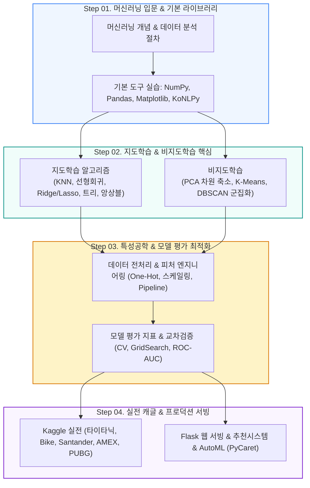

# 🤖 인공지능 머신러닝 기본 (ML Basic Class)

<p align="center">
  <a href="https://ldjwj.github.io/ML_Basic_Class">
    
  </a>
  
  
  
</p>

> **환영합니다!** 본 저장소는 머신러닝의 핵심 개념과 알고리즘 원리부터 실무 데이터 전처리, 모델 평가·최적화, 캐글(Kaggle) 컴피티션 실전, 그리고 Flask 웹 서비스 배포까지 단계별로 학습할 수 있는 **온라인 오픈 강의 교재**입니다.  
> ⭐️ 내용이 도움 되셨다면 우측 상단의 **Star** 버튼을 꾹 눌러주세요!

<p align="center">
  <a href="#-학습-로드맵">🗺️ 학습 로드맵</a> •
  <a href="#-강의-교재-pdf-인덱스">📚 강의 교재(PDF)</a> •
  <a href="#-머신러닝-알고리즘-실습-소스코드">💻 알고리즘 실습</a> •
  <a href="#-캐글kaggle-실전-컴피티션">🏆 캐글 실전</a> •
  <a href="#-응용-프로젝트--웹-서빙">🚀 응용 & 서빙</a>
</p>

---

## 🗺️ 학습 로드맵

머신러닝의 기초 이론부터 실제 웹 서비스 배포까지 유기적으로 연결된 4단계 커리큘럼입니다.



---

## 📚 강의 교재 (PDF) 인덱스

강의에 사용되는 슬라이드 교재를 PDF로 열람 및 다운로드하실 수 있습니다.

| 단계 / 주제 | 교재 제목 | 파일 링크 |
|:---|:---|:---:|
| **ML 입문 & 개요** | 머신러닝 용어 이해, 구분, 데이터 분석 절차 (최신 v16) | [📄 PDF](https://ldjwj.github.io/ML_Basic_Class/part03_ml/part03_ch01_01_ml/ch01_01_ML입문_Detail_v16_202610.pdf) |
| | 머신러닝 기본 이해 (개요판, 최신 v22) | [📄 PDF](https://ldjwj.github.io/ML_Basic_Class/part03_ml/part03_ch01_01_ml/ch01_01_ML입문_v22_202610.pdf) |
| | 머신러닝 기본: 파이썬과 첫 모델 만들기 (최신 v14) | [📄 PDF](https://ldjwj.github.io/ML_Basic_Class/part03_ml/part03_ch01_01_ml/ch01_02_ML기본_v14_202610.pdf) |
| **지도학습 (회귀/분류)** | KNN & 선형회귀 (최신 V119 개정판, with opencode) | [📄 PDF](https://ldjwj.github.io/ML_Basic_Class/part03_ml/ch02_01_ML_KNN_회귀_V119_2610.pdf) |
| | KNN & 선형회귀 (초보자용 입문) | [📄 PDF](https://ldjwj.github.io/ML_Basic_Class/part03_ml/part03_ch02_01_knn_linear_ppt/ch02_AI_KNN_회귀_HighSc_V10.pdf) |
| | 로지스틱 회귀 (Logistic Regression) | [📄 PDF](https://ldjwj.github.io/ML_Basic_Class/part03_ml/part03_ch02_01_knn_linear_ppt/ch02_logistic_v03_202610.pdf) |
| | 의사결정트리 (Decision Tree) | [📄 PDF](https://ldjwj.github.io/ML_Basic_Class/part03_ml/part03_ch02_02_decisiontree/ch02_03_01_decisiontree_v11_2205.pdf) |
| | 앙상블 기법 - 배깅·랜덤포레스트·부스팅·LightGBM (01·02 통합) | [📄 PDF](https://ldjwj.github.io/ML_Basic_Class/part03_ml/part03_ch02_03_ensemble/ch02_Ensemble_v12_202610.pdf) |
| **전처리 & 비지도학습** | 데이터 전처리 및 피처 엔지니어링 (최신 v12, 2026.10) | [📄 PDF](https://ldjwj.github.io/ML_Basic_Class/part03_ml/part03_ch03_01_datapre/ch03_04_01_DataProcessing_202610_v12.pdf) |
| | 파이프라인 (Pipeline) 개념 (v11, 2026.10) | [📄 PDF](https://ldjwj.github.io/ML_Basic_Class/part03_ml/part03_ch03_01_datapre/ch03_04_02_Pipeline_202610_v11.pdf) |
| | 비지도학습 01 기본 개요 | [📄 PDF](https://ldjwj.github.io/ML_Basic_Class/part03_ml/part03_ch03_02_pca/ch03_비지도학습01_Basic_v02_202610.pdf) |
| | 비지도학습 02 PCA 주성분 분석 | [📄 PDF](https://ldjwj.github.io/ML_Basic_Class/part03_ml/part03_ch03_02_pca/ch03_pca_v02_202610.pdf) |
| **평가 & 추천 시스템** | 머신러닝 모델 평가지표 완벽 정리 | [📄 PDF](https://ldjwj.github.io/ML_Basic_Class/part03_ml/part03_ch05_validation/ch05_평가지표_v05_202610.pdf) |
| | 머신러닝 심화 & 모델 업그레이드 전략 (최신 v02) | [📄 PDF](https://ldjwj.github.io/ML_Basic_Class/part03_ml/part03_ch06_upgrade/ch06_upgrade_v02_202610.pdf) |
| | 추천 시스템 (Recommendation System) 개요 (최신 v03) | [📄 PDF](https://ldjwj.github.io/ML_Basic_Class/part04_practical/ch07_추천시스템_v03_202610.pdf) |

---

## 💻 머신러닝 알고리즘 실습 소스코드

웹 브라우저에서 바로 볼 수 있는 **HTML 뷰어**와 인쇄/소장용 **PDF**를 모두 지원합니다.

### 1. 기본 라이브러리 & 탐색적 데이터 분석 (EDA)
| 주제 | 상세 내용 | 바로가기 |
|:---|:---|:---:|
| **Pandas** | 데이터 탐색 기초 (IRIS) | [🌐 HTML](https://ldjwj.github.io/ML_Basic_Class/part03_ml/1_2_LIB_Pandas_Basic01_IRIS_V11.html) · [📄 PDF](https://ldjwj.github.io/ML_Basic_Class/part03_ml/1_2_LIB_Pandas_Basic01_IRIS_V11.pdf) |
| | 핵심 메서드 활용 (`unique`, `value_counts`) | [🌐 HTML](https://ldjwj.github.io/ML_Basic_Class/part03_ml/1_2_LIB_Pandas_Basic02_IRIS_V11.html) · [📄 PDF](https://ldjwj.github.io/ML_Basic_Class/part03_ml/1_2_LIB_Pandas_Basic02_IRIS_V11.pdf) |
| **Matplotlib** | 시각화 기본 차트 그리기 | [🌐 HTML](https://ldjwj.github.io/ML_Basic_Class/part03_ml/1_2_LIB_Matplotlib_Basic01_IRIS_V11.html) · [📄 PDF](https://ldjwj.github.io/ML_Basic_Class/part03_ml/1_2_LIB_Matplotlib_Basic01_IRIS_V11.pdf) |
| **Scikit-learn** | 사이킷런 첫걸음 (IRIS 데이터셋 로드) | [🌐 HTML](https://ldjwj.github.io/ML_Basic_Class/part03_ml/1_2_LIB_sklearn_Basic01_IRIS_V02.html) · [📄 PDF](https://ldjwj.github.io/ML_Basic_Class/part03_ml/1_2_LIB_sklearn_Basic01_IRIS_V02.pdf) |
| **NumPy & NLP** | 다차원 배열 연산 및 벡터화 | [🌐 HTML](https://ldjwj.github.io/ML_Basic_Class/part03_ml/1_1_numpy라이브러리_V11.html) · [📄 PDF](https://ldjwj.github.io/ML_Basic_Class/part03_ml/1_1_numpy라이브러리_V11.pdf) |
| | 한국어 형태소 분석 (KoNLPy on Colab) | [🌐 HTML](https://ldjwj.github.io/ML_Basic_Class/part03_ml/1_2_LIB_KONLPY_V10.html) · [📄 PDF](https://ldjwj.github.io/ML_Basic_Class/part03_ml/1_2_LIB_KONLPY_V10.pdf) |
| | 유튜브 댓글 텍스트 분석 & 워드클라우드 | [🌐 HTML](https://ldjwj.github.io/ML_Basic_Class/part03_ml/1_2_LIB_KONLPY_Youtube03_V10.html) · [📄 PDF](https://ldjwj.github.io/ML_Basic_Class/part03_ml/1_2_LIB_KONLPY_Youtube03_V10.pdf) |

### 2. 지도학습 (Supervised Learning)
| 분류 | 상세 주제 | 자료 링크 |
|:---|:---|:---:|
| **첫 모델** | 첫 번째 머신러닝 모델 생성 및 학습 흐름 | [🌐 HTML](https://ldjwj.github.io/ML_Basic_Class/part03_ml/ch01_01_ML_start_v14_2606.html) |
| **KNN** | K-최근접 이웃 알고리즘 구현 | [🌐 HTML](https://ldjwj.github.io/ML_Basic_Class/part03_ml/ch02_01_01A_knn_code_v12_504.html) · [📄 PDF](https://ldjwj.github.io/ML_Basic_Class/part03_ml/ch02_01_01A_knn_code_v12_504.pdf) |
| | KNN 실전 연습 문제 | [🌐 HTML](https://ldjwj.github.io/ML_Basic_Class/part03_ml/ch02_01_01B_knn_code_pratice_2205.html) · [📄 PDF](https://ldjwj.github.io/ML_Basic_Class/part03_ml/ch02_01_01B_knn_code_pratice_2205.pdf) |
| **선형 모델** | 단순/다중 선형회귀 구현 | [🌐 HTML](https://ldjwj.github.io/ML_Basic_Class/part03_ml/ch02_01_02A_linear_code_v12.html) · [📄 PDF](https://ldjwj.github.io/ML_Basic_Class/part03_ml/ch02_01_02A_linear_code_v12.pdf) |
| | 회귀 평가지표 상세 분석 (당뇨병 데이터) | [🌐 HTML](https://ldjwj.github.io/ML_Basic_Class/part03_ml/ch02_01_02B_diabete_evaluation_v13_2601.html) · [📄 PDF](https://ldjwj.github.io/ML_Basic_Class/part03_ml/ch02_01_02B_diabete_evaluation_v13_2601.pdf) |
| | 규제 선형회귀 (Ridge, Lasso) | [🌐 HTML](https://ldjwj.github.io/ML_Basic_Class/part03_ml/ch02_01_03_ridge_lasso.html) · [📄 PDF](https://ldjwj.github.io/ML_Basic_Class/part03_ml/ch02_01_03_ridge_lasso.pdf) |
| | 로지스틱 이진 분류 (Binary) | [🌐 HTML](https://ldjwj.github.io/ML_Basic_Class/part03_ml/ch02_01_04_binary_classification.html) · [📄 PDF](https://ldjwj.github.io/ML_Basic_Class/part03_ml/ch02_01_04_binary_classification.pdf) |
| | 다중 클래스 분류 (Multiclass) | [🌐 HTML](https://ldjwj.github.io/ML_Basic_Class/part03_ml/ch02_01_05_multiclass_classification_v10.html) · [📄 PDF](https://ldjwj.github.io/ML_Basic_Class/part03_ml/ch02_01_05_multiclass_classification_v10.pdf) |
| **트리 & 앙상블** | 의사결정트리 기본 (Colab) | [🌐 HTML](https://ldjwj.github.io/ML_Basic_Class/part03_ml/ch02_03_01_decisionTree_colab.html) · [📄 PDF](https://ldjwj.github.io/ML_Basic_Class/part03_ml/ch02_03_01_decisionTree_colab.pdf) |
| | 의사결정트리 당뇨병 데이터 실습 | [🌐 HTML](https://ldjwj.github.io/ML_Basic_Class/part03_ml/ch02_03_02_decisionTree_diabetes_colab.html) · [📄 PDF](https://ldjwj.github.io/ML_Basic_Class/part03_ml/ch02_03_02_decisionTree_diabetes_colab.pdf) |
| | `dtreeviz`를 활용한 트리 시각화 모델 해석 | [🌐 HTML](https://ldjwj.github.io/ML_Basic_Class/part03_ml/ch02_03_02_dtreeviz_modelVis_v10_2209.html) · [📄 PDF](https://ldjwj.github.io/ML_Basic_Class/part03_ml/ch02_03_02_dtreeviz_modelVis_v10_2209.pdf) |
| | 랜덤포레스트 - Tips 데이터 실습 (1, 2) | [🌐 HTML 01](https://ldjwj.github.io/ML_Basic_Class/part03_ml/ch02_03_03_RandomForest_01_Tips_01.html) · [🌐 HTML 02](https://ldjwj.github.io/ML_Basic_Class/part03_ml/ch02_03_03_RandomForest_01_Tips_02.html) |
| | 랜덤포레스트 - 유방암(Cancer) 분류 | [🌐 HTML](https://ldjwj.github.io/ML_Basic_Class/part03_ml/ch02_03_03_RandomForest_02_cancer.html) · [📄 PDF](https://ldjwj.github.io/ML_Basic_Class/part03_ml/ch02_03_03_RandomForest_02_cancer.pdf) |
| | 그래디언트 부스팅 결정 트리 (GBM) | [🌐 HTML](https://ldjwj.github.io/ML_Basic_Class/part03_ml/ch02_03_05_gradient_boosting_class_v11.html) · [📄 PDF](https://ldjwj.github.io/ML_Basic_Class/part03_ml/ch02_03_05_gradient_boosting_class_v11.pdf) |

### 3. 데이터 전처리, 비지도학습, 모델 검증
| 카테고리 | 상세 내용 | 링크 |
|:---|:---|:---:|
| **전처리** | 결측치 처리 및 데이터 스케일링 | [🌐 HTML](https://ldjwj.github.io/ML_Basic_Class/part03_ml/ch03_01_01_데이터전처리_2208.html) · [📄 PDF](https://ldjwj.github.io/ML_Basic_Class/part03_ml/ch03_01_01_데이터전처리_2208.pdf) |
| | 범주형 데이터 원-핫 인코딩 (One-Hot) | [🌐 HTML](https://ldjwj.github.io/ML_Basic_Class/part03_ml/ch04_01_01_FE_OneHotEncoding_01.html) · [📄 PDF](https://ldjwj.github.io/ML_Basic_Class/part03_ml/ch04_01_01_FE_OneHotEncoding_01.pdf) |
| | 구간 분할(Binning) & 로그 변환 | [🌐 HTML](https://ldjwj.github.io/ML_Basic_Class/part03_ml/ch04_05_01_FE_binned_202010.html) · [📄 PDF](https://ldjwj.github.io/ML_Basic_Class/part03_ml/ch04_06_01_FE_log_202010.pdf) |
| | 머신러닝 파이프라인 (Pipeline Code) | [🌐 HTML](https://ldjwj.github.io/ML_Basic_Class/part03_ml/ch04_08_01_Pipeline_Code_2210.html) · [📄 PDF](https://ldjwj.github.io/ML_Basic_Class/part03_ml/ch04_08_01_Pipeline_Code_2210.pdf) |
| **비지도학습** | PCA 차원 축소 기본 및 얼굴 이미지 예제 | [🌐 HTML](https://ldjwj.github.io/ML_Basic_Class/part03_ml/ch03_04_01_차원축소(1)_PCA_2208.html) · [📄 PDF](https://ldjwj.github.io/ML_Basic_Class/part03_ml/ch03_04_02_차원축소(2)_PCA_얼굴예제.pdf) |
| | t-SNE 비선형 차원 축소 시각화 | [🌐 HTML](https://ldjwj.github.io/ML_Basic_Class/part03_ml/ch03_04_03_차원축소(3)_tsne_2208.html) · [📄 PDF](https://ldjwj.github.io/ML_Basic_Class/part03_ml/ch03_04_03_차원축소(3)_tsne_2208.pdf) |
| | K-Means 군집화 & DBSCAN 밀도 군집화 | [🌐 HTML](https://ldjwj.github.io/ML_Basic_Class/part03_ml/ch03_02_01_군집(clustering)_Kmeans_2208.html) · [🌐 HTML](https://ldjwj.github.io/ML_Basic_Class/part03_ml/ch03_05_02_DBSCAN_2207.html) |
| **평가 & 튜닝** | 교차 검증 (Cross-Validation 1, 2) | [🌐 HTML 01](https://ldjwj.github.io/ML_Basic_Class/part03_ml/ch05_01_01_CrossValidation_v01_2208.html) · [🌐 HTML 02](https://ldjwj.github.io/ML_Basic_Class/part03_ml/ch05_01_02_CrossValidation_v02_2208.html) |
| | 그리드 서치 (GridSearchCV) 하이퍼파라미터 탐색 | [🌐 HTML 01](https://ldjwj.github.io/ML_Basic_Class/part03_ml/ch05_02_03_GridSearch_tree_SVC_2208.html) · [🌐 HTML 02](https://ldjwj.github.io/ML_Basic_Class/part03_ml/ch05_02_02_성능개선_GridSearch2.html) |
| | ROC-AUC 곡선 & 분류 임계값(Threshold) 조정 | [🌐 HTML](https://ldjwj.github.io/ML_Basic_Class/part03_ml/ch05_03_03_validation(3)-ROCAUC_2207.html) · [📄 PDF](https://ldjwj.github.io/ML_Basic_Class/part03_ml/ch05_03_02_validation(2)_threshold_2207.pdf) |

---

## 🏆 캐글(Kaggle) 실전 컴피티션

실제 공개 대회 데이터셋을 활용하여 베이스라인 모델 구축부터 피처 엔지니어링, 상위 솔루션 튜닝까지 다룹니다.

<details open>
<summary><b>🔥 주요 캐글 대회별 실습 내역 (클릭하여 접기/펼치기)</b></summary>

### 1. 타이타닉 생존자 예측 (Titanic)
* [입문] 첫 제출 파일 만들기 [🌐 HTML](https://ldjwj.github.io/ML_Basic_Class/part03_ml/part03_pro_titanic/ch02_03_02A_titanic_firstsub_2205.html) · [📄 PDF](https://ldjwj.github.io/ML_Basic_Class/part03_ml/part03_pro_titanic/ch02_03_02A_titanic_firstsub_2205.pdf)
* [EDA] 데이터 탐색 및 모델 비교 [🌐 HTML](https://ldjwj.github.io/ML_Basic_Class/part03_ml/part03_pro_titanic/ch02_03_02B_titanic.html) · [📄 PDF](https://ldjwj.github.io/ML_Basic_Class/part03_ml/part03_pro_titanic/ch02_03_02B_titanic.pdf)
* [피처 엔지니어링] Cabin(객실), Ticket(티켓번호) 파싱 고도화 [🌐 HTML Cabin](https://ldjwj.github.io/ML_Basic_Class/part03_ml/part03_pro_titanic/ch02_03_02B_titanic_01_Cabin(0_67703).html) · [🌐 HTML Ticket](https://ldjwj.github.io/ML_Basic_Class/part03_ml/part03_pro_titanic/ch02_03_02B_titanic_02_Ticket_gender.html)
* [모델 평가] 타이타닉 검증 전략 [🌐 HTML](https://ldjwj.github.io/ML_Basic_Class/part03_ml/ch05_03_05_validation_titanic_2211.html)

### 2. 자전거 수요 예측 (Bike Sharing Demand)
* (1) EDA 및 데이터 시각화 [🌐 HTML](https://ldjwj.github.io/ML_Basic_Class/part03_ml/01_06_Bike_EDA_02_2107.html) · [📄 PDF](https://ldjwj.github.io/ML_Basic_Class/part03_ml/01_06_Bike_EDA_02_2107.pdf)
* (2) Ridge & Lasso 회귀 모델 구축 [🌐 HTML](https://ldjwj.github.io/ML_Basic_Class/part03_ml/ch02_Bike02_Ridge_Lasso_v13_2210.html) · [📄 PDF](https://ldjwj.github.io/ML_Basic_Class/part03_ml/ch02_Bike02_Ridge_Lasso_v13_2210.pdf)
* (3) 다중 모델 비교 및 성능 검증 [🌐 HTML](https://ldjwj.github.io/ML_Basic_Class/part03_ml/ch02_Bike03_MultiModel_v12.html) · [🌐 HTML 검증](https://ldjwj.github.io/ML_Basic_Class/part03_ml/ch02_Bike04_ModelValidation_v10.html)

### 3. 아메리칸 익스프레스 채무불이행 예측 (AMEX Default Prediction)
* [대회 링크](https://www.kaggle.com/competitions/amex-default-prediction/overview)
* 베이스라인 모델 (XGBoost) [🌐 HTML](https://ldjwj.github.io/ML_Basic_Class/part03_ml/part03_pro_kaggle/amex_01_basemodel_xgbm_2210.html)
* 대용량 데이터 고속 학습 (LightGBM) [🌐 HTML](https://ldjwj.github.io/ML_Basic_Class/part03_ml/part03_pro_kaggle/amex-02-basic-lightgbm_2208.html)
* GPU 가속 범주형 모델링 (CatBoost) [🌐 HTML](https://ldjwj.github.io/ML_Basic_Class/part03_ml/part03_pro_kaggle/amex-03-catboost-md10-gpu_2208.html)

### 4. 산탄데르 고객 만족 예측 (Santander Customer Satisfaction)
* [대회 링크](https://www.kaggle.com/c/santander-customer-satisfaction)
* 불균형 데이터 ROC-AUC 최적화 [🌐 HTML](https://ldjwj.github.io/ML_Basic_Class/part03_ml/ch08_01_santander_roc_auc_2208.html) · [📄 PDF](https://ldjwj.github.io/ML_Basic_Class/part03_ml/ch08_01_santander_roc_auc_2208.pdf)
* LightGBM 하이퍼파라미터 튜닝 [🌐 HTML](https://ldjwj.github.io/ML_Basic_Class/part03_ml/ch08_02_santander_lightgbm_2208.html) · [📄 PDF](https://ldjwj.github.io/ML_Basic_Class/part03_ml/ch08_02_santander_lightgbm_2208.pdf)

### 5. 배틀그라운드(PUBG) 승자 순위 예측 & 시계열 매출 예측
* PUBG 선형회귀 베이스라인 [🌐 HTML](https://ldjwj.github.io/ML_Basic_Class/part03_ml/part03_pro_kaggle/pubg_01_simplesub_wk_2211.html) · [📄 PDF](https://ldjwj.github.io/ML_Basic_Class/part03_ml/part03_pro_kaggle/pubg_01_simplesub_wk_2211.pdf)
* 미래 매출 예측 (Predict Future Sales) [🌐 HTML 01](https://ldjwj.github.io/ML_Basic_Class/part03_ml/part03_pro_kaggle/01_predict_future_sales_v10.html) · [🌐 HTML 02](https://ldjwj.github.io/ML_Basic_Class/part03_ml/part03_pro_kaggle/02_predict_future_sales_v10.html)
* 데이콘(Dacon) 주차 수요 예측 베이스라인 [🌐 HTML](https://ldjwj.github.io/ML_Basic_Class/part03_ml/part03_pro_kaggle/dacon_07_feature_engineering_01.html) · [GitHub Repo](https://github.com/LDJWJ/parking_demand_competion)

</details>

---

## 🚀 응용 프로젝트 & 웹 서빙

```
┌─────────────────────────────────┐       ┌─────────────────────────────────┐
│     🌐 Flask 머신러닝 웹 서비스   │  -->  │      🛒 지능형 추천 시스템       │
│  - IRIS 붓꽃 품종 실시간 판별     │       │  - 협업 필터링 (아이템/유저)     │
│  - 캘리포니아 집값 예측 웹 UI    │       │  - TF-IDF 콘텐츠 기반 순수 JS 데모│
└─────────────────────────────────┘       └─────────────────────────────────┘
```

### 1. Flask를 활용한 머신러닝 웹 서비스 배포
학습된 모델(`.pkl`)을 경량 웹 프레임워크인 Flask에 탑재하여 실시간 사용자 입력 기반 예측을 서비스합니다.
* **붓꽃 품종 판별 웹 서비스**: [🌐 HTML](https://ldjwj.github.io/ML_Basic_Class/part04_practical/Flask(플라스크)_머신러닝_웹서비스구축.html) · [📄 PDF](https://ldjwj.github.io/ML_Basic_Class/part04_practical/Flask_Web01_IRIS.pdf)
* **집값 예측 웹 서비스**: [🌐 HTML](https://ldjwj.github.io/ML_Basic_Class/part04_practical/Flask(플라스크)_활용한_머신러닝_웹서비스구축(2).html) · [📄 PDF](https://ldjwj.github.io/ML_Basic_Class/part04_practical/Flask_Web02_House.pdf)
* **악성종양(암) 예측 웹 서비스**: [🌐 HTML](https://ldjwj.github.io/ML_Basic_Class/part04_practical/Flask_ML_Web서비스(3)_Cancer.html) · [📄 PDF](https://ldjwj.github.io/ML_Basic_Class/part04_practical/Flask_Web03_Cancer.pdf)

### 2. 추천 시스템 (Recommendation System)
* 영화 평점 기반 유사 영화 추천 (협업 필터링): [🌐 HTML](https://ldjwj.github.io/ML_Basic_Class/part04_practical/ch07_03_협업필터링_movie_01_2211.html) · [📄 PDF](https://ldjwj.github.io/ML_Basic_Class/part04_practical/ch07_03_협업필터링_movie_01_2211.pdf)
* TF-IDF 기반 콘텐츠 추천 시스템: [🌐 HTML](https://ldjwj.github.io/ML_Basic_Class/part04_practical/ch07_04_콘텐츠기반_TFIDF_movie_2606.html)
* **[인터랙티브 데모]** 브라우저에서 직접 영화 선택 후 실시간 추천받기: [🎮 웹 데모 실행](https://ldjwj.github.io/ML_Basic_Class/part04_practical/ch07_04_콘텐츠기반_TFIDF_movie_interactive_2606.html)

### 3. AutoML (PyCaret) & 데이터베이스 연동 파이프라인
* **PyCaret AutoML**: 원클릭 모델 비교 및 앙상블 [🌐 HTML](https://ldjwj.github.io/ML_Basic_Class/part03_ml/ch08_03_Automl_pycaret01_2211.html)
* **우주 타이타닉 (Spaceship Titanic)** AutoML 솔루션: [🌐 HTML](https://ldjwj.github.io/ML_Basic_Class/part03_ml/ch08_03_Automl_spaceship_titanic_2207.html)
* **SQLite DB & Pandas**: 데이터 파이프라인 연동 [🌐 HTML 01](https://ldjwj.github.io/ML_Basic_Class/part03_ml/ch08_01_ml_db.html) · [🌐 HTML 02](https://ldjwj.github.io/ML_Basic_Class/part03_ml/ch08_ml_db_02.html)

---

## 🔗 참고 자료 및 라이선스

* **참고 도서**: *파이썬 라이브러리를 활용한 머신러닝 (O'Reilly)*
* **문의 사항**: 저작권 문의 및 제휴: [frontier1020@naver.com](mailto:frontier1020@naver.com)
* **라이선스**: 본 저장소의 모든 자료는 [CC BY-NC 4.0](LICENSE) 라이선스를 따릅니다. 출처를 표시하면 비영리 목적으로 자유롭게 활용 및 공유하실 수 있습니다.
